# Домашнее задание № 02 — «Основы Terraform. Yandex Cloud»

**Курс:** Netology  
**Тема:** создание инфраструктуры в Yandex Cloud с помощью Terraform  
**Репозиторий:** `netology-terraform-yandex-02`

## Цель работы

1. Создать ресурсы в Yandex Cloud с помощью Terraform.
2. Освоить работу с переменными Terraform.
3. Описать инфраструктуру кодом и проверить, что фактическое состояние облака соответствует конфигурации.

В работе выполнены основные задания **1–6**. Дополнительные задания **7–9 со звёздочкой** не выполнялись, поскольку они необязательные и не влияют на получение зачёта.

> **Важное замечание перед сдачей.** В приложенных снимках обе виртуальные машины ещё имеют статус `RUNNING`. В исходном ТЗ есть требование удалить созданные ресурсы. Перед окончательной сдачей необходимо выполнить `terraform destroy` и проверить, что ресурсы удалены. Удаление в этом отчёте не отмечается как выполненное.

## Результат

С помощью Terraform описаны и созданы:

- облачная сеть `develop`;
- отдельная подсеть для web-ВМ;
- отдельная подсеть для db-ВМ;
- две виртуальные машины Ubuntu;
- единый output `instances` с именами, внешними IP и FQDN обеих ВМ.

Финальная проверка конфигурации завершилась сообщением:

```text
Success! The configuration is valid.

No changes. Your infrastructure matches the configuration.
```

## Выполнение заданий

### Задание 1. Подготовка Yandex Cloud и первый запуск Terraform

- Создан сервисный аккаунт `terraform-sa`.
- Создан ключ сервисного аккаунта. Локальный файл ключа размещён по пути `~/.config/yandex-cloud/authorized_key.json`; права на файл ограничены владельцем (`chmod 600`).
- Установлен Yandex Cloud CLI. В проверке использовалась версия `1.44.0`.
- Создан и активирован профиль CLI `terraform-sa`, выполнена авторизация.
- Создан SSH-ключ Ed25519. В конфигурацию ВМ передаётся публичная часть ключа через `metadata["ssh-keys"]`.
- Для Terraform использовалась версия `1.12.2`, соответствующая ограничению `~> 1.12.0`.
- Настроен Yandex provider с `cloud_id`, `folder_id` и путём к ключу сервисного аккаунта.
- Выполнены `terraform init`, `terraform fmt`, `terraform validate`, `terraform plan` и `terraform apply`.
- Выполнено подключение к web-ВМ по SSH и проверена команда `curl ifconfig.me`.

Команда `curl ifconfig.me` вернула `84.201.131.239`. Это совпадает с внешним IP web-ВМ из вывода `yc compute instance list` и `terraform output`.

#### Исправленные проблемы конфигурации

Во время первоначальной настройки были выявлены и исправлены следующие проблемы:

1. Путь к ключу сервисного аккаунта был задан с `~` внутри обычного строкового пути. Для корректного раскрытия домашнего каталога использован `pathexpand("~/.config/yandex-cloud/authorized_key.json")`.
2. При первом запуске был указан неверный `folder_id`, из-за чего API вернул `Folder ... not found`. Значение сверили со списком каталогов Yandex Cloud и исправили.
3. В исходной конфигурации было некорректное значение платформы `standart-v4`. Для web-ВМ указана доступная платформа `standard-v1`.

#### Ответы на вопросы задания 1

**Для чего нужен `preemptible = true`?**

Параметр включает прерываемую виртуальную машину. Такой вариант подходит для учебных стендов, тестов и временных задач, когда важнее снизить стоимость, чем гарантировать непрерывную работу. Для постоянно работающих критичных сервисов такой режим не подходит: виртуальная машина может быть остановлена облачной платформой.

**Для чего нужен `core_fraction = 5`?**

Параметр задаёт гарантированную долю производительности виртуального CPU. Значение `5` означает низкую гарантированную долю CPU и позволяет дешевле запускать учебные или малонагруженные виртуальные машины. Для более интенсивных задач требуется более высокая доля CPU. В проекте `core_fraction = 5` задан для web-ВМ, а для db-ВМ — `20`.

### Задание 2. Замена жёстко заданных значений переменными

Параметры образа и виртуальной машины вынесены в отдельные типизированные Terraform-переменные.

Для web-ВМ используются переменные с префиксом `vm_web_`, например:

- `vm_web_image_family`;
- `vm_web_name`;
- `vm_web_platform_id`;
- `vm_web_preemptible`;
- `vm_web_nat`.

Переменные размещены в `vms_platform.tf`. Значения по умолчанию сохранены в конфигурации. После рефакторинга выполнялся `terraform plan`; на финальном этапе план не показывает расхождений с созданной инфраструктурой.

### Задание 3. Создание второй виртуальной машины

Создан файл `vms_platform.tf` с переменными web- и db-ВМ. В `main.tf` добавлены отдельные ресурсы для db-ВМ:

- `yandex_vpc_subnet.db`;
- `data.yandex_compute_image.db`;
- `yandex_compute_instance.db`.

Параметры db-ВМ:

- имя: `netology-develop-platform-db`;
- CPU: 2 vCPU;
- RAM: 2 ГБ;
- `core_fraction = 20`;
- подсеть: `develop-db`;
- CIDR: `10.0.2.0/24`;
- `preemptible = true`.

**Отклонение от зоны, указанной в ТЗ.** В задании указана зона `ru-central1-b`. При создании db-ВМ API вернул ошибку `Zone ru-central1-b is not available`. После переноса db-ВМ в `ru-central1-d` платформа `standard-v1` также оказалась недоступна в этой зоне, поэтому для db-ВМ была выбрана `standard-v3`. С этими параметрами создание завершилось успешно. Фактическая конфигурация и снимки результата отражают именно этот рабочий вариант.

### Задание 4. Output для обеих виртуальных машин

В `outputs.tf` объявлен один output `instances`. Он содержит для каждой ВМ:

- `instance_name`;
- `external_ip`;
- `fqdn`.

Значения берутся непосредственно из атрибутов ресурсов Terraform, без ручного прописывания IP-адресов и имён в output.

### Задание 5. Использование locals

В `locals.tf` создан один блок `locals` с вычисляемыми именами обеих ВМ:

- `local.vm_web_name`;
- `local.vm_db_name`.

Имена формируются интерполяцией нескольких переменных: префикса проекта, имени VPC и имени соответствующей ВМ. В ресурсах виртуальных машин используются значения `local`, а не повторяющиеся вручную строки.

### Задание 6. Объединение параметров ресурсов и metadata

Параметры CPU, RAM и доли CPU объединены в переменную `vms_resources` типа `map(object(...))`. В ней отдельно описаны конфигурации `web` и `db`.

Общая переменная `metadata` вынесена отдельно и передаётся обеим виртуальным машинам через `metadata = var.metadata`. В текущем коде её тип — `map(string)`, поскольку значения metadata являются строками.

Более не используемые отдельные переменные ресурсов закомментированы. После изменений выполнены:

```bash
terraform fmt
terraform validate
terraform plan
```

Финальный `terraform plan` показал `No changes`.

## Итоговая инфраструктура

### Сеть и подсети

| Ресурс | Зона | CIDR |
|---|---|---|
| VPC `develop` | — | — |
| Подсеть `develop` для web | `ru-central1-a` | `10.0.1.0/24` |
| Подсеть `develop-db` для db | `ru-central1-d` | `10.0.2.0/24` |

### Виртуальные машины

| Параметр | Web | DB |
|---|---|---|
| Имя | `netology-develop-platform-web` | `netology-develop-platform-db` |
| Зона | `ru-central1-a` | `ru-central1-d` |
| Платформа | `standard-v1` | `standard-v3` |
| CPU | 2 vCPU | 2 vCPU |
| RAM | 1 ГБ | 2 ГБ |
| `core_fraction` | 5 | 20 |
| `preemptible` | `true` | `true` |
| Внутренний IP | `10.0.1.26` | `10.0.2.20` |
| Внешний IP | `84.201.131.239` | `51.250.35.158` |

### Результат `terraform output`

```hcl
instances = {
  db = {
    external_ip  = "51.250.35.158"
    fqdn         = "fv4qteaaodg888j31agj.auto.internal"
    instance_name = "netology-develop-platform-db"
  }
  web = {
    external_ip  = "84.201.131.239"
    fqdn         = "fhmpivasdeggq9kd2b5h.auto.internal"
    instance_name = "netology-develop-platform-web"
  }
}
```

## Скриншоты выполнения

Снимки сделаны во время выполнения работы 11 ноября 2026 года. Это исходные скриншоты из процесса настройки и проверки.

### 1. Сервисный аккаунт и инструменты

Сервисный аккаунт `terraform-sa`:

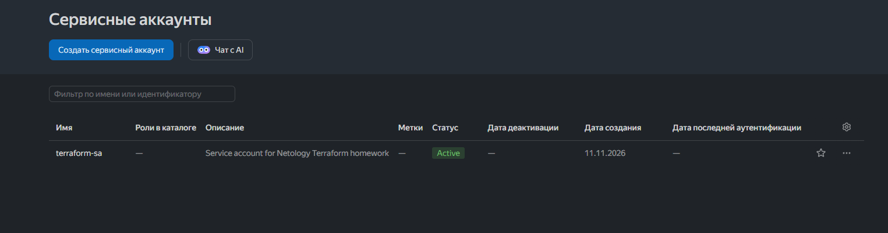

Версия Yandex Cloud CLI:

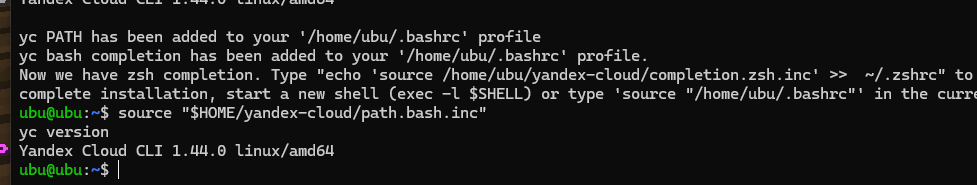

Права на локальный файл ключа сервисного аккаунта:

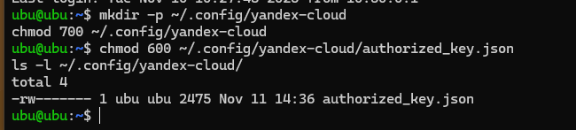

Профиль Yandex CLI и создание SSH-ключа:

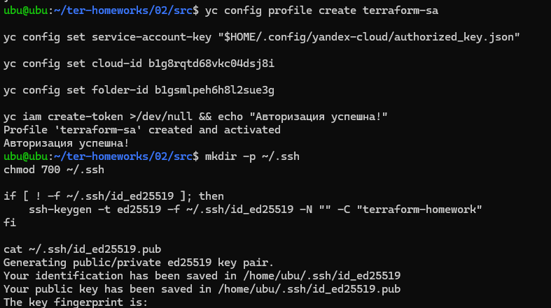

### 2. Подключение к web-ВМ

Подключение по SSH и проверка внешнего IP командой `curl ifconfig.me`:

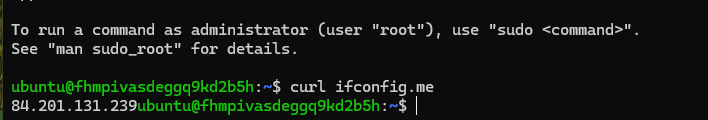

### 3. Конфигурация и создание ресурсов

Фрагмент конфигурации сети, подсетей, образов и виртуальных машин:

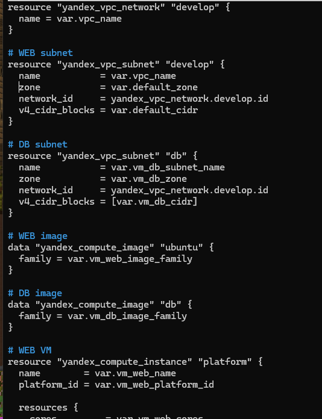

При первоначальном создании db-ВМ в зоне `ru-central1-b` API вернул ошибку доступности зоны:

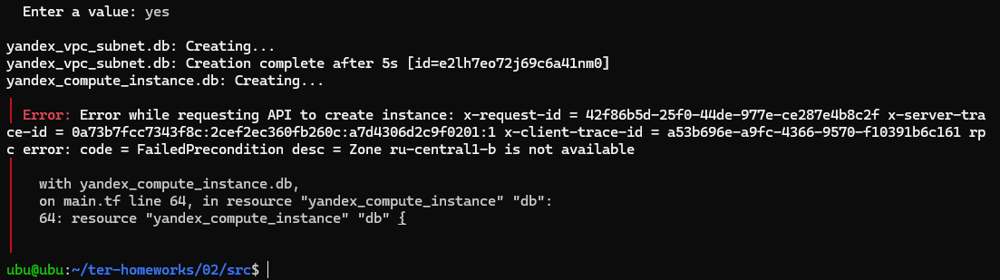

После переноса db-ВМ в `ru-central1-d` потребовалась смена платформы с `standard-v1` на `standard-v3`:

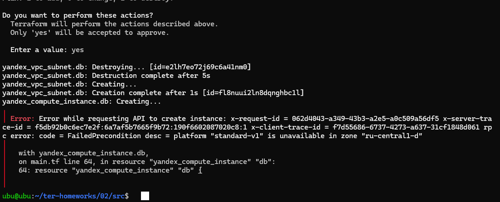

### 4. Проверка результата

Обе виртуальные машины созданы и отображаются в статусе `RUNNING`; на скриншоте также видны внешние и внутренние IP-адреса:

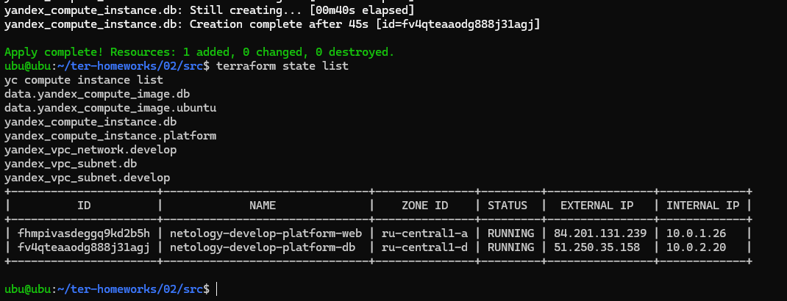

Результат команды `terraform output`:

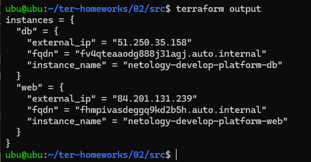

Финальные `terraform fmt`, `terraform validate` и `terraform plan`; план сообщает `No changes`:

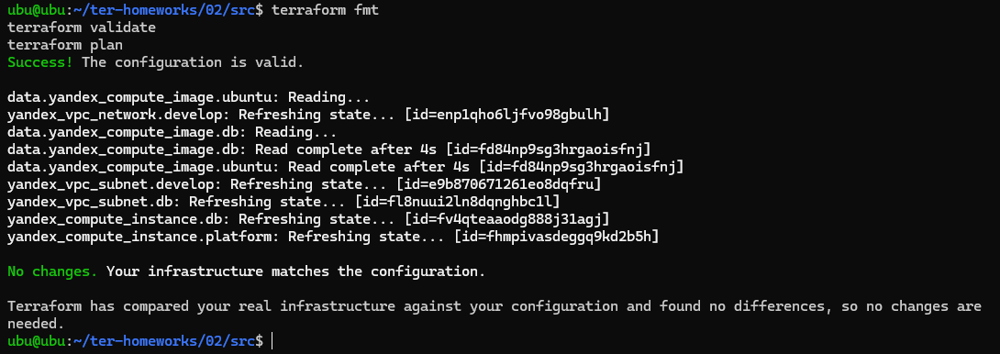

> В доступных скриншотах есть вывод `yc compute instance list` с обеими ВМ и их IP-адресами. Отдельный снимок страницы Compute Cloud в веб-консоли с карточками этих ВМ в истории чата не обнаружен.

## Структура репозитория

```text
.
├── README.md
├── docs/
│   └── screenshots/
│       ├── 01-service-account-created.png
│       ├── 02-yandex-cli-version.png
│       ├── 03-service-account-key-permissions.png
│       ├── 04-cli-profile-and-ssh-key.png
│       ├── 05-ssh-curl-ifconfig.png
│       ├── 06-terraform-network-and-vm-config.png
│       ├── 07-db-zone-b-unavailable.png
│       ├── 08-standard-v1-unavailable-in-zone-d.png
│       ├── 09-both-vms-running.png
│       ├── 10-terraform-output.png
│       └── 11-final-plan-no-changes.png
└── src/
    ├── .gitignore
    ├── .terraform.lock.hcl
    ├── console.tf
    ├── locals.tf
    ├── main.tf
    ├── outputs.tf
    ├── providers.tf
    ├── terraform.tfvars.example
    ├── variables.tf
    └── vms_platform.tf
```

## Как запустить проект

1. Установить Terraform `1.12.x` и Yandex Cloud CLI.
2. Настроить сервисный аккаунт и локально сохранить его ключ в `~/.config/yandex-cloud/authorized_key.json`.
3. Перейти в каталог `src`.
4. Создать локальный файл переменных:

```bash
cp terraform.tfvars.example terraform.tfvars
```

5. Заполнить в `terraform.tfvars` собственные `cloud_id`, `folder_id` и публичный SSH-ключ.
6. Выполнить:

```bash
terraform init
terraform fmt
terraform validate
terraform plan
terraform apply
terraform output
```

`terraform.tfvars` не добавляется в репозиторий. Не публикуйте JSON-ключ сервисного аккаунта, приватный SSH-ключ или файлы `terraform.tfstate`.

## Удаление ресурсов

В исходном задании отдельно указано удалить все созданные ресурсы. После проверки результатов выполните из каталога `src`:

```bash
terraform destroy
```

Подтвердите удаление только после проверки списка ресурсов. После этого проверьте в Yandex Cloud, что созданные сеть, подсети и виртуальные машины удалены.

## Дополнительные задания

Задания 7, 8 и 9 со звёздочкой не выполнялись. В исходном ТЗ они обозначены как дополнительные и необязательные.
